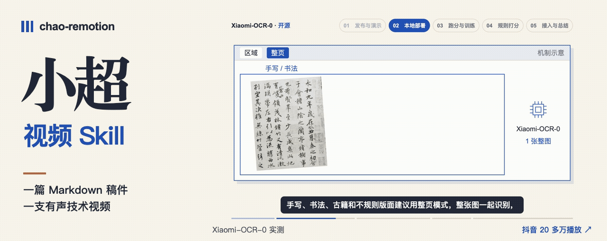
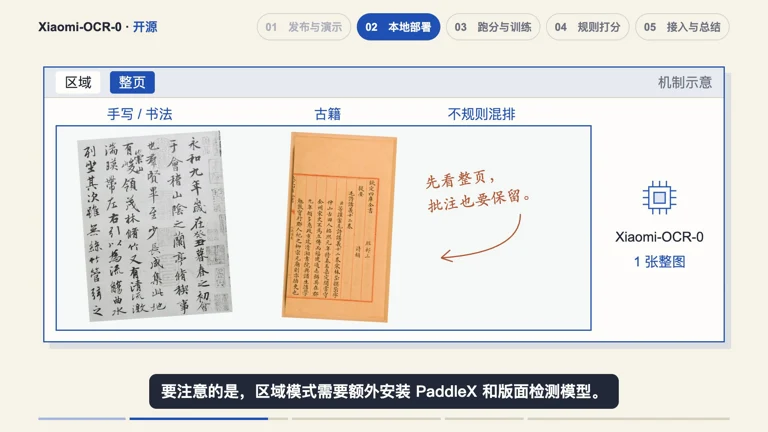
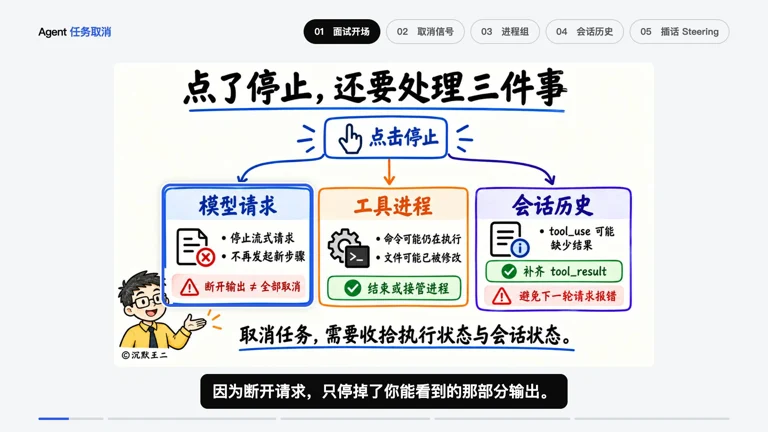
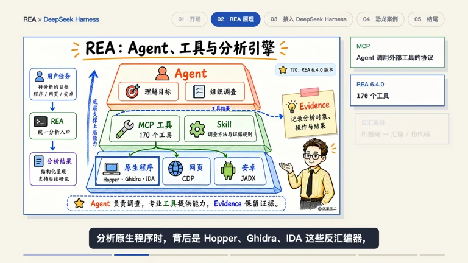
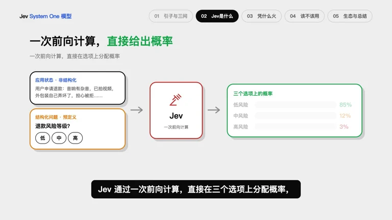
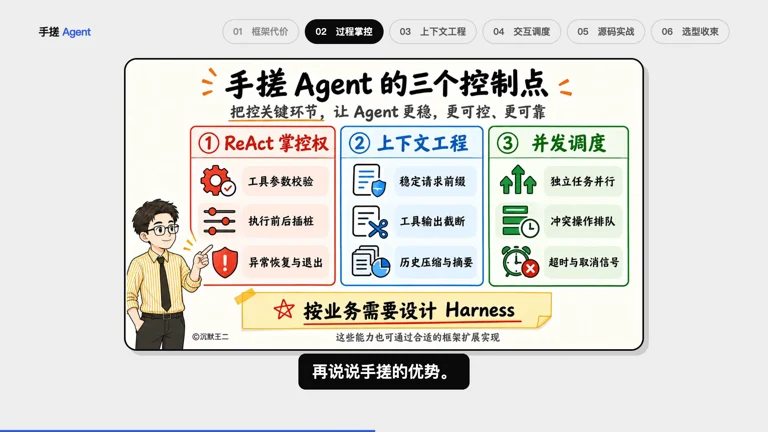

[](https://www.douyin.com/video/7702772455210896674)

# 小超视频 Skill

把 Markdown 口播稿做成有配音、字幕和分章动画的技术视频。在 Codex 或 DeepSeek Harness 里，安装和开工各说一句就行。

<a id="quickstart"></a>

**第一次用，把这句话发给助手：**

```text
帮我安装一下小超视频 Skill：https://github.com/itwanger/chao-remotion
```

**开始做视频时，把稿件路径发给它：**

```text
用小超视频 Skill 制作 xxx.md
```

**第一章做好，助手会自动启动有声预览，把第一章的链接发给你。** 打开就能看，也可以直接说「这里先放全图，再放大表格里的数字」。看过这一章，说「继续」就做下一章；全片满意后，说「出片」就导出 MP4。

<a id="showcase"></a>

## 五期实战作品

从「王二讲Agent」飞书题库收录的 102 个抖音作品中按点赞数选取。下表为 **2026 年 11 月 9 日**从抖音公开播放器读取的点赞快照。小米 OCR 一期的 **20 多万播放**由作者确认。

| 成片里的画面 | 作品与看点 | 抖音点赞 |
| --- | --- | ---: |
| [](https://www.douyin.com/video/7702772455210896674) | [小米 Xiaomi-OCR-0 开源实测](https://www.douyin.com/video/7702772455210896674)<br>把倾斜文字、表格和竖排文字放进同一轮真实对照。 | **6,418** |
| [](https://www.douyin.com/video/7693089537089604874) | [用户中途取消，Agent 任务怎么停下来？](https://www.douyin.com/video/7693089537089604874)<br>从一次“停止”操作追到模型请求、工具进程和会话历史。 | **3,807** |
| [](https://www.douyin.com/video/7696102369058196736) | [REA 保姆级教程 · DeepSeek Harness 实操](https://www.douyin.com/video/7696102369058196736)<br>跟着一个实际任务，看分析工具怎样接入 Agent。 | **3,643** |
| [](https://www.douyin.com/video/7687944233659026722) | [Jev 如何在选项之间做判断？](https://www.douyin.com/video/7687944233659026722)<br>把输入、备选答案和返回的概率排进同一幅画面。 | **2,586** |
| [](https://www.douyin.com/video/7684942306939954856) | [为什么选择手写 Agent？](https://www.douyin.com/video/7684942306939954856)<br>用 ReAct、上下文工程和并行调用讲清工程取舍。 | **2,293** |

## 小超的画风

讲工具时，镜头先交代完整界面，再聚焦到正在操作的按钮。讲机制时，让对象跟着口播变化：取消信号从模型走到工具，算好的 K/V 留在原位供下一次请求复用。暖米色是底，蓝色标出当前对象，铁锈橙点出变化。[视觉规范](docs/style.md)

想改模板或运行示例，可看[开发说明](docs/development.md)。

仓库的原创代码与模板使用 [MIT 许可](LICENSE)。案例视频、视频中的原始界面与第三方素材保留各自权利；Remotion 的使用遵循其[上游许可](https://github.com/remotion-dev/remotion/blob/main/LICENSE.md)。
