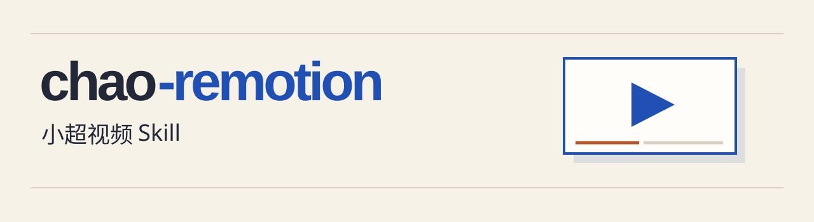

# chao-remotion

把一篇中文 Markdown 口播稿做成有配音、字幕和分章动画的技术视频。给 Codex 或 DeepSeek Harness 一句话就能开工：

> **用小超视频 Skill 制作 xxx.md**

「小超」是这套视频的画风。暖米色画布上，蓝色标出正在讲的对象，铁锈橙点出发生变化的地方。讲实测时先把界面交代清楚，再把镜头送到按钮、原文或结果上。讲机制时，让信号真的传到工具、让缓存真的被复用。下面五期都用过这套制作方法。

<a id="showcase"></a>

## 看成片

从「王二讲Agent」飞书题库收录的 102 个抖音作品中按点赞数选取。下表为 **2026 年 11 月 9 日**从抖音公开播放器读取的点赞快照。小米 OCR 一期的 **20 多万播放**由作者确认。

| 成片里的画面 | 作品与看点 | 抖音点赞 |
| --- | --- | ---: |
| [](https://www.douyin.com/video/7702772455210896674) | [小米 Xiaomi-OCR-0 开源实测](https://www.douyin.com/video/7702772455210896674)<br>把倾斜文字、表格和竖排文字放进同一轮真实对照。 | **6,418** |
| [](https://www.douyin.com/video/7693089537089604874) | [用户中途取消，Agent 任务怎么停下来？](https://www.douyin.com/video/7693089537089604874)<br>从一次“停止”操作追到模型请求、工具进程和会话历史。 | **3,807** |
| [](https://www.douyin.com/video/7696102369058196736) | [REA 保姆级教程 · DeepSeek Harness 实操](https://www.douyin.com/video/7696102369058196736)<br>跟着一个实际任务，看分析工具怎样接入 Agent。 | **3,643** |
| [](https://www.douyin.com/video/7687944233659026722) | [Jev 如何在选项之间做判断？](https://www.douyin.com/video/7687944233659026722)<br>把输入、备选答案和返回的概率排进同一幅画面。 | **2,586** |
| [](https://www.douyin.com/video/7684942306939954856) | [为什么选择手写 Agent？](https://www.douyin.com/video/7684942306939954856)<br>用 ReAct、上下文工程和并行调用讲清工程取舍。 | **2,293** |

## 安装与使用

在放口播稿的项目根目录运行下列命令。Codex 与 DeepSeek Harness 都能从项目的 `.agents/skills/` 发现 Skill。

```bash
git clone https://github.com/itwanger/chao-remotion.git .agents/skills/chao-remotion
```

重新打开该工作区或开始新会话，输入 **「用小超视频 Skill 制作 xxx.md」**。把 `xxx.md` 换成稿件的实际路径。要在多个项目共用，可将仓库克隆到 `~/.agents/skills/chao-remotion`。

Skill 会整理原稿、编排章节，把解说中的对象做成动画，在 Remotion Studio 逐章预览。配音可以使用自己的录音、macOS 已安装的中文语音，或自己配置的火山 TTS。制作方法见 [SKILL.md](SKILL.md)，画面取舍见[小超风格指南](docs/style.md)。

## 跑一个例子

下面用「前缀缓存」演示如何维持画面里的四个前缀单元，再把新输入加到右边。需要 Node.js 22、npm、Python 3.9+；有声制作还需要 FFmpeg 和 ffprobe。Remotion 首次渲染会准备浏览器，也可以通过 `REMOTION_BROWSER_EXECUTABLE` 指向已有 Chrome。

在刚才克隆的 `chao-remotion` 目录中执行：

```bash
python3 scripts/init.py examples/prefix-cache.md ./output/cache-demo
cd output/cache-demo
npm ci
npm run studio
```

Studio 中的 `Chapter1`、`Chapter2` 可分别审片，`Video` 播放全片。初始示例用于看动作；在工程目录执行以下命令，即可用 macOS 系统声音给示例配音，再导出 `output/video.mp4`：

```bash
python3 audio.py --mac-voice Tingting
npm run render
```

其他系统可用 `python3 audio.py --recordings ./recordings` 导入音频。[配音与时间轴说明](docs/audio.md)

仓库的原创代码与模板使用 [MIT 许可](LICENSE)。案例视频、视频中的原始界面与第三方素材保留各自权利；Remotion 的使用遵循其[上游许可](https://github.com/remotion-dev/remotion/blob/main/LICENSE.md)。
